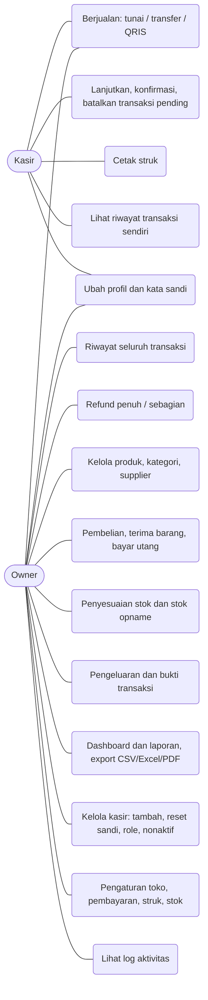
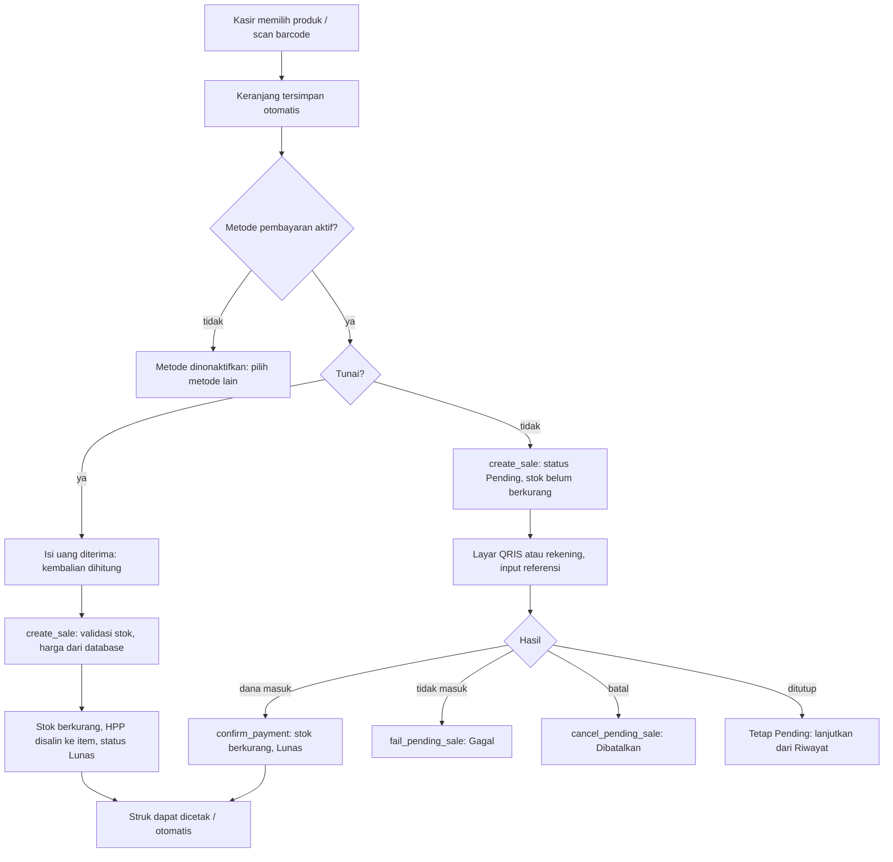
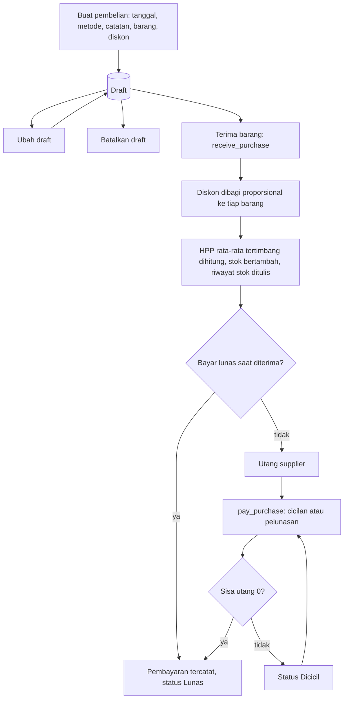
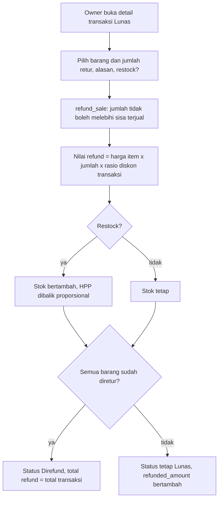
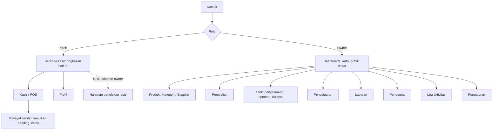
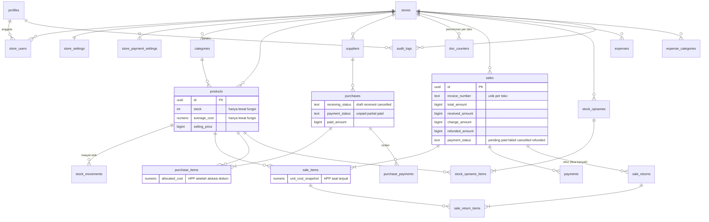

# Diagram Phase 1

Semua diagram memakai Mermaid (tampil otomatis di GitHub, GitLab, dan VS Code dengan ekstensi Mermaid).
Diagram mengikuti perilaku yang **diimplementasikan dan diuji** di migrasi 0001-0010.

## 1. Use case

## 2. Activity: penjualan

## 3. Activity: pembelian, HPP, dan utang

## 4. Activity: refund / retur sebagian

## 5. User flow per role

## 6. ERD

